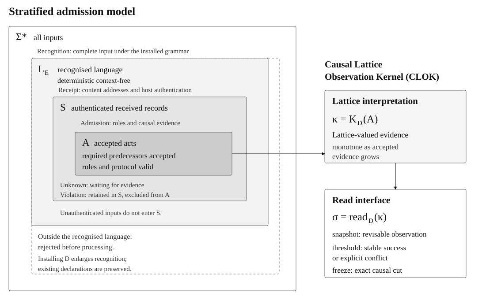

# CBCL

[](LICENSE)
[](https://git.anuna.io/anuna-research/cbcl-rs/releases/tag/v0.1.1)
[](CHANGELOG.md#unreleased)
[](Cargo.toml)

**A language for composing multi-agent protocols.**

CBCL (Common Business Communication Language) lets agents define, exchange, and participate in multiparty protocols at runtime, without a central coordinator or a shared global message order. This repository provides the Rust implementation and Lean proofs.

Agents teach each other new interaction vocabularies as messages. Protocols can also define shared state and bounded resources: replicas derive state from accepted acts, while escrow rights constrain concurrent spending. Signed, content-addressed evidence supports verification of public protocol behaviour and detection of equivocation.

These guarantees concern observable interactions. They do not establish that an agent’s claims are true or that compliant actions are beneficial.

CBCL is in pre-1.0 development. See the [changelog](CHANGELOG.md) for released
features, unreleased changes, and migration notes.

## How it works

CBCL separates recognised inputs, authenticated received records and accepted
acts. Each participant maintains its own evidence; replicas merge records by set
union, and acts cite their predecessors rather than relying on arrival order.



1. **Recognition.** The installed environment defines a deterministic context-free
   language, L_E. Every input is recognised in full before semantic processing;
   inputs outside L_E are rejected. Installing a dialect extends recognition
   while preserving existing declarations.
2. **Receipt.** Content addresses and host authentication establish the received
   set S. Unauthenticated inputs do not enter S. Merging these sets by union
   tolerates duplicates and requires no global delivery order.
3. **Admission.** The accepted subset A contains acts whose roles and protocol
   checks pass and whose required predecessors are already accepted. `Unknown`
   waits for evidence; `Violation` records remain in S but are excluded from A.
   One passed causal check alone does not admit an act.
4. **Lattice interpretation.** The Causal Lattice Observation Kernel (CLOK)
   joins contributions from A into lattice-valued evidence. Equal accepted sets
   under the same fixed dialect and authenticated metadata give equal kernel
   values, regardless of delivery order.
5. **Observation.** The read interface distinguishes revisable snapshots, stable
   threshold successes that may later expose explicit conflict, and exact values
   at causal freeze cuts. The underlying lattice evidence grows even when a
   displayed snapshot changes non-monotonically.

Transport delivers records, cryptography authenticates authors and integrity,
and CBCL verifies interaction rules. Authentication establishes who said what,
not that the statement is true. Bounded resources need rights plus issuance
discipline; set union alone does not prevent double spending. See the
[full architecture diagram](docs/diagrams/cbcl-architecture.svg) and the
[protocol model](docs/concepts/protocol-model.md) for the broader system and its
formal guarantees.

## Quick start

Install Rust stable, then:

```bash
git clone https://git.anuna.io/anuna-research/cbcl-rs
cd cbcl-rs
cargo run -p cbcl-cli -- parse '(tell agent-b "hello")'
cargo run -p cbcl-cli -- verify '(define greeting () @alice (extend greet (who) (tell who "hello")))'
```

AArch64 Unix builds also require a target C compiler/assembler (Xcode Command Line Tools on macOS). WASM builds do not use that assembly dependency.

The workspace declares Rust 1.75 as its minimum version; `rust-toolchain.toml` selects stable.

## Usage

The CLI supports parsing, dialect verification, an agent REPL, and gossip simulation:

```bash
cargo run -p cbcl-cli -- agent --id @alice
cargo run -p cbcl-cli -- --help
```

`parse`, `verify`, and `simulate` read from stdin when their input argument is omitted. To verify your own dialect file, use `cargo run -p cbcl-cli -- verify < dialect.scm`.

Custom performatives require an explicit `(lang …)` scope; installed dialects do not provide an unscoped fallback.

For dialect authors, start with the [language EBNF](docs/cbcl-grammar.ebnf) and
[state language reference](docs/reference/state-language.md), which lists the
state keywords, argument syntax, installation checks, and read semantics.
See also [roles and casts](docs/concepts/role-cast.md) and
[protocol progress](docs/concepts/protocol-progress.md).

### Numeric atoms

`integer` accepts signed 64-bit integer atoms. `number` accepts integers, finite
floats, and exact decimals without converting their representations.

| Type | Literal examples | Shape type |
|---|---|---|
| Signed 64-bit integer | `42`, `-7` | `integer`; `nonnegative` additionally requires a value ≥ 0 |
| Finite IEEE 754 binary64 float | `1.25`, `1.`, `1e-3`, `1E+2` | `float` |
| Exact arbitrary-precision decimal | `12m`, `12.3400m`, `-0.01m` | `decimal` |

Numeric literals start with a digit or `-` followed by a digit. The decimal suffix
is lowercase `m`; decimal exponents and `1.m` are rejected. `+1.0`, `.5`, and
`-.5` are symbols rather than numeric literals. Floats must decode to finite
binary64 values; an overflowing literal such as `1e9999` is rejected.

Serialization normalizes values: `1e2` becomes `100.0`, `-0.0` becomes `0.0`,
and `0012.3400m` becomes `12.34m`. Floats use fixed-point decimal text with
round-tripping digits and retain `.0` for integral values. Decimals remove
redundant zeroes without passing through binary floating point; their storage
grows with the normalized text rather than using a fixed-width decimal format.

Inside a dialect, declare reusable contracts and use them in shapes:

```lisp
(type postal-code (string (matches "[0-9]{4}")))
(type percentage (number (>= 0) (<= 100)))
(type currency (one-of :AUD :USD :EUR))
(type display-name (string (length (>= 1) (<= 80))))
(type batch (list (length (> 0) (<= 100))))
(shape quote
  (require :quantity integer)
  (require :price decimal)
  (require :postcode postal-code)
  (optional :currency currency (default :AUD)))
```

Types can reference later declarations. Use `and` for intersections and `or` for
alternatives; cycles, unknown names, and duplicate definitions reject installation.
These are pure value checks: they preserve the value and run no author code.
Numeric bounds compare exact represented values; decimal `0.1m` is exactly one tenth.
Regexes use RFC 9485 I-Regexp with full-string matching and Unicode 16.0.0 properties.
String lengths count Unicode scalars; list lengths count immediate elements.
Enumeration membership preserves atom representations, so `(one-of 1)` rejects `1.0`.
Resource exhaustion reports `resource-limit`, separately from a contract violation.

Errors identify the declared type, failed refinement, numbered composition branch,
and nested field path. For example, a postal-code mismatch explains
`type postal-code: refinement clause 1 failed: matches "[0-9]{4}" (whole string)`;
a length failure names its bound, such as `length (<= 100)`.
An unsuccessful `or` summarizes its alternatives instead of reporting only the first failure.
Malformed regexes report one-based Unicode character positions in the decoded pattern.
Resource errors explain required/available work or the exceeded input limit.
Field contents are omitted; constraint literals come from the authored declaration.

[SPEC-040](specs/SPEC-040-numeric-and-refinement-types.md) defines the profile and limits.
Signing form 6 binds `cbcl-flat-v1-unicode16` and all local type definitions.
Existing dialect signatures and self-addresses require explicit reissue; old
integer-only `number` declarations should be rewritten as `integer`. Optional
defaults now use `(default value)` explicitly.

The [EBNF](docs/cbcl-grammar.ebnf) distinguishes numeric atoms from integer-only
`number` grammar productions. `integer` and `nonnegative` shapes, counter arithmetic,
resource bounds, repeat counts, finite-lattice tables, and threshold literals
retain their integer semantics. The `number` shape category accepts all three
numeric representations, including ordinary float and decimal state data.

Canonical atom tags are `F` and `D`; existing integer encodings are unchanged.
NIF floats are BEAM floats; decimals are `{decimal, <<"12.34">>}`. JSON state and
act views carry decimals as `{"decimal":"12.34"}` to preserve precision in browsers.

For bindings, see [JavaScript/TypeScript](js/README.md), [WebAssembly](README-WASM.md), and [Erlang/BEAM](crates/cbcl-erl/README.md). The JavaScript/TypeScript package includes a JSON-authored object runtime.

## Current capabilities

- **Causal contracts:** three-valued verification (`Unknown`, `Valid`, `Violation`) over mergeable message stores, with accepted-history admission and an extractable causal kernel.
- **Multiparty roles:** endpoint projection and role-local verification under R6 causal locality.
- **Evidence widening:** payload-free causal evidence, bounded protocol repetition, and equivocation detection.
- **Typed content addresses:** Merkle roots over message fields, v3 root signatures, and authenticated field-openings for selective disclosure. Openings support causal safety; completion-level fan-in still requires full messages.

Field-openings preserve the need for causal evidence: a bare hash cannot establish a missing predecessor's type.

## Message store

Each agent keeps a local, content-addressed message store. Messages belong to threads and cite predecessor content addresses through `:caused-by`. Each message’s address commits to those references. With authenticated content addresses and admission requiring already-accepted predecessors, accepted history forms a causal Merkle DAG; the raw store alone does not enforce these conditions. The store is an append-only, deduplicated set: exchanging messages merges knowledge by set union, without requiring a global delivery order. The core provides an in-memory implementation; transport and durable storage belong to the host.

Verification consults this store for predecessor evidence. If a required predecessor has not arrived, the result can remain `Unknown`; later delivery lets the agent check again. Causal-closure bundles package a message and its transitive predecessors for transfer, while the frontier identifies messages not yet referenced by another message in the thread.

Receipt alone does not mean acceptance. The admission monitor separates pending candidates from accepted history and verifies against accepted predecessors. State rules then derive an object's state from its accepted acts. Replicas with different evidence can temporarily differ; replicas with the same accepted acts derive the same state.

## State and bounded counters

An optional `(state …)` declaration defines what a dialect author can observe
from a thread's accepted acts. Every field uses the shared
[Causal Lattice Observation Kernel (CLOK)](specs/SPEC-038-lvar-state-kernel.md): accepted evidence
accumulates by lattice join, and the field's read rule determines its observable
value. With the same installed dialect and interpretation of authenticated
metadata, equal accepted sets give equal observations regardless of arrival
order or duplicate delivery.

The read guarantee matters as much as the value: a snapshot may revise, a
threshold establishes a stable fact unless the history faults, and a freeze
reads an exact causal cut. A displayed count or balance alone does not establish
finality. `fold` evaluates these observations; `intend` uses the current accepted
history to bind a proposed act. These APIs are exposed through Rust,
JavaScript/TypeScript, WASM, C, and Erlang.

Protocol and role checks govern admission; state rules interpret the admitted
history. Authors can compose registers, sets, maps, counters, progress, and
read-only context, or declare a finite lattice with contribution and projection
tables checked at installation. Progress and resource fields retain history in
the kernel so their reads can follow causal dependencies.

Each source defines how its evidence is displayed. `initial` reads opener data
and faults on competing openers. Multi-value registers and maps retain concurrent
surviving values; explicit `lww-*` rules select a winner using trusted-host HLC
metadata. An HLC orders eligible writes within those rules. Explicit supersession
removes named writes before winner selection, and deletion leaves unobserved
concurrent writes intact. Resource counters additionally check spending rights
and issuance authority against causal evidence. See
[choosing a state rule](docs/concepts/hlc-registers.md#choosing-a-state-rule)
for examples and assumptions.

### LVar reads, freezes, and context

Dialect authors choose the read guarantee explicitly:

- A **snapshot** reports the current value and may change as more acts arrive.
- A **threshold** reports a stable fact. Once reached, it keeps the same answer
  unless later evidence produces a terminal fault; it never silently returns to
  pending. Installation checks the source type and alternative compatibility.
- A **freeze** reads the source at the earliest freezer's causal cut. Later or
  concurrent contributions are excluded under the default `supersede` policy,
  or fault the read under `fault`. Concurrent earliest freezers also fault.
  Domain dependencies count as contributions too: an initializer or roster root
  outside the cut can fault a field that depends on it.
- A **fault** carries evidence of the inconsistent history and persists as
  accepted history grows.

For example, these declarations belong inside a dialect's `(state …)` clause,
with `approve` and `close` defined by its protocol:

```lisp
(approvals (count approve))
(threshold enough approvals (count 3))
(sealed-approvals (count approve))
(freeze sealed-approvals close supersede)
```

The count is a snapshot. `enough` reads the current raw approval carrier;
`sealed-approvals` becomes an exact causal-cut read after `close`. Installation
rejects thresholds on `supersede`-frozen sources, so these use separate fields.

`(context)` exposes a read-only map of installed dialect metadata, sealed thread
metadata and role rosters, and current observation metadata. Paths such as
`(context thread roles reviewer)` expose a declared role's roster; rosters can
supply domains and membership thresholds. Observation metadata such as
`(context observation frontier)` remains a snapshot. Context supplies ordinary
kernel data; the dialect defines its quorum policy.

The original state heads remain available. `progress` and `bounded-counter`
retain accepted history in the kernel and reuse the protocol-position and
resource-DAG validators. Authors can also declare finite lattices and
contribution tables, whose lattice laws and read policies are checked at
installation. Thresholds and freezes do not provide an exactly-once external
effect contract; hosts still handle effect deduplication and recovery.

The **bounded-counter primitive** represents transferable rights over constrained resources, supporting balances, quotas, credits, and inventory. These escrow rights are bound to authenticated accounts: each account can decrement within its allocation, and transferring rights changes who can spend without changing the total. An optional ceiling adds per-account headroom for increments. Concurrent operations are authorized against these allocations rather than a global observed balance.

| Operation | Effect |
|-----------|--------|
| Increment | Raises the value; requires issuer authority and, when capped, headroom |
| Decrement | Lowers the value; consumes the signer's rights |
| Transfer | Moves rights between accounts; preserves the value |

Account ownership supports individual allocations. Collective pools and quorum-budget certification require the explicit certificate runtime; the plain state fold reports an unsupported-profile fault for those modes. Examples: `dialects/example-coin.cbcl`, `dialects/example-capped-coin.cbcl`, and `dialects/example-collective-tickets.cbcl`. See [bounded-counter guide](docs/concepts/bounded-counter.md) for declarations and invariants.

The built-in checkpoint companion dialect supports cached member-certified state
opening through `cbcl-checkpoint`. It reuses native signed endorsements, verifies
continuation and local-history coverage, and retains signed evidence. It supplies
neither resource-release authority nor global freshness. See
[checkpoint runtime](crates/cbcl-checkpoint/README.md).

### Example: a coin with a bounded counter

`dialects/example-coin.cbcl` declares a coin. `open` fixes each account's allocation, `mint` and `burn` change the value, and `pay` moves spending rights without changing it:

```lisp
; Bounded-counter example. Amounts are integer base units, not decimals.
; Hosts authenticate acts and serialize issuance per account before publication.
(define example-coin (cbcl) @coin-author
  (:resource-requirements ((max-depth 16) (max-expansion-size 4096) (verification-time 1000)))
  (:roles (issuer (* holder)))
  (extend open (to name allocations) :from issuer :to (issuer holder)
    (tell to :name name :allocations allocations))
  (extend mint (to amount) :from issuer :to (issuer holder)
    (tell to :amount amount))
  (extend burn (to amount) :from holder :to (issuer holder)
    (tell to :amount amount))
  (extend pay (to recipient amount) :from holder :to (issuer holder)
    (tell to :recipient recipient :amount amount))
  (shape open (require :name string) (require :allocations list))
  (shape mint (require :amount integer))
  (shape burn (require :amount integer))
  (shape pay (require :recipient symbol) (require :amount integer))
  (protocol (then begin open) (then open mint) (then open burn) (then open pay))
  (state
    (name (initial open :name))
    (coins (bounded-counter
      (floor 0)
      (initial-rights open :allocations)
      (issuers issuer)
      (increment mint :amount)
      (decrement burn :amount)
      (transfer pay :recipient :amount)))))
```

Opening with allocations `((@treasury 1000) (@alice 0) (@bob 0))`, then treasury pays Alice 100, Alice pays Bob 25, Bob burns 5 and treasury mints 250, leaves this state:

```json
{"name":"Example Coin","coins":{"status":"ready","value":1245,"rights":{"@treasury":1150,"@alice":75,"@bob":20}}}
```

The source account of every operation is the authenticated signer, never a caller-supplied field. A `pay` or `burn` beyond the signer's rights is refused with `insufficient rights`, even when another account has unused rights. The message forms, the `intend` call that produces them, and how key identities connect to roles and allocations are in [example coin](docs/concepts/example-coin.md).

## Architecture

`cbcl-core` and `cbcl-parser` form the deterministic `no_std + alloc` core and forbid unsafe code. CLI, WASM, C FFI, and Erlang NIF crates provide the effectful interfaces.

Lean proofs live in `lean-cbcl/`, including R1–R5 properties, endpoint-projection correspondence, finite-time delivery results, and R6 DCFL preservation. Splicing and selective-disclosure results concern abstract predecessor-type evidence; concrete field-opening authentication remains a separate refinement obligation. Explicit host-HLC LWW registers and conflict-preserving aliases are described in [HLC registers](docs/concepts/hlc-registers.md); their clock honesty premise is separate from resource certification. State-fold and binder properties are proved in `State.lean`; [conditional strong eventual consistency](specs/SPEC-037-state-kernel-sec.md) connects equal-set observations to fair admission and eventual delivery; [whole typed kernel correctness](specs/SPEC-036-state-kernel-correctness.md) additionally proves independent denotational correctness and elaboration completeness for arbitrary finite supported clauses, with resource-verifier classification explicitly outside the theorem; corpus tests check Rust/model correspondence, while universal Rust-driver refinement remains open. The concrete R6 checks are tested in Rust; their semantic guarantees are mechanised in Lean. The axiom audit allowlist includes explicit content-hash and causal-accessor assumptions.

SPEC-038 additionally proves typed native resource-verifier/certificate equivalence, concrete typed authored source binding, installed-rule/plan refinement and complete authored agreement for the implemented single-source observation inventory. Its v0.4 sealed-root migration is implemented; native condition thresholds are implemented, while their extended Lean compiler/oracle and proof coverage remain in progress. Universal native Rust extraction and mutable-driver correspondence remain proof boundaries; see the [Lean proof status](lean-cbcl/README.md#causal-lattice-observation-kernel-clok). The [acceptance evidence](docs/reviews/lvar-kernel-acceptance.md) records tested requirements and unresolved contracts. For other proof boundaries, see [proof design notes](proofs/epp-correspondence/design.md) and `scripts/check-axioms.sh`.

## API reference

Generate local Rust documentation with `cargo doc --workspace --no-deps`. Start with:

| Task | API |
|------|-----|
| Parse and validate | `cbcl_parser::run_pipeline` |
| Store messages and traverse causality | `cbcl_core::store::{MessageStore, ThreadedMessageStore, CausalClosureBundle}` |
| Admit messages into accepted history | `cbcl_core::admission::AdmissionMonitor` |
| Verify causal evidence | `cbcl_core::protocol::verify_causal` |
| Compute state and bind intent | `cbcl_core::state::fold`, `cbcl_core::intend::intend` |
| Project and verify roles | `cbcl_core::projection::{project, verify_causal_for_role}` |
| Open committed fields | `cbcl_core::typed_addr::{typed_root, open, verify_opening}` |
| Authenticate disclosed evidence | `cbcl_core::envelope::{build_opened, verify_opened}` |

## Development

```bash
make check
cargo bench --workspace
```

Run `make help` for build, install, distribution, and documentation targets. `make install` installs the CLI as `cbcl` under `~/.local/bin` (override `PREFIX` as needed). `make dist` stages a native binary and checksum locally.

To release from a clean `main` matching `origin/main`, run `./release.sh X.Y.Z` with a higher stable version. It updates the shared workspace version and lockfile, runs Rust and Lean checks, commits, and pushes `main` plus an annotated `vX.Y.Z` tag atomically. It does not publish packages or binaries. Git, Rust, Make, Python 3, and Lean/lake are required.

Cached-checkpoint continuation for all 16 native rule heads is proved in
[`CheckpointAll.lean`](lean-cbcl/LeanCbcl/CheckpointAll.lean), including ordered
aggregate sources and projected protocol/resource facts. The theorem connects
compact incremental state to the existing native evaluator over accepted
identities; it is not a universal Rust extraction or resource-finality proof.
See the [proof guide](lean-cbcl/README.md#cached-checkpoint-continuation) for the boundary
and reproducible checks.

For proof changes, install Lean via elan and run `lake build` and `lake exe runLinter LeanCbcl` from `lean-cbcl/`. Run `scripts/check-axioms.sh` from the repository root. For mutation testing, see [mutation-testing guide](docs/mutation-testing.md).
Use the [live Lean state-kernel oracle](docs/state-kernel-oracle.md) for differential fuzzing with shrinking and replay.

Contributions are welcome. Specs live under `specs/`, implementation plans under `plans/`, and bug reports under `bugs/`. Link changes to their governing requirements and verification evidence.

State conformance vectors live in `test-vectors/state/`. For client-observed certificate finality measurements, see [quorum benchmark](tools/quorum-e2e/README.md).

## Background and license

The theoretical framework is published in the [2026 IEEE Symposium on Security and Privacy Workshops (SPW)](https://www.computer.org/csdl/proceedings-article/spw/2026/107000a039/2hIfzFiEfjG), pp. 39–48. A [preprint](https://arxiv.org/abs/2604.14512) is also available. The original prototype is the [Scheme implementation](https://github.com/anuna-research/cbcl).

Licensed under the [Apache License 2.0](LICENSE).

## Citation

```bibtex
@inproceedings{cbcl2026,
  title     = {{CBCL}: Safe Self-Extending Agent Communication},
  author    = {O'Connor, Hugo},
  booktitle = {2026 IEEE Symposium on Security and Privacy Workshops (SPW)},
  year      = {2026},
  pages     = {39--48},
  publisher = {IEEE},
  doi       = {10.1109/SPW72489.2026.00007},
  url       = {https://www.computer.org/csdl/proceedings-article/spw/2026/107000a039/2hIfzFiEfjG}
}
```
